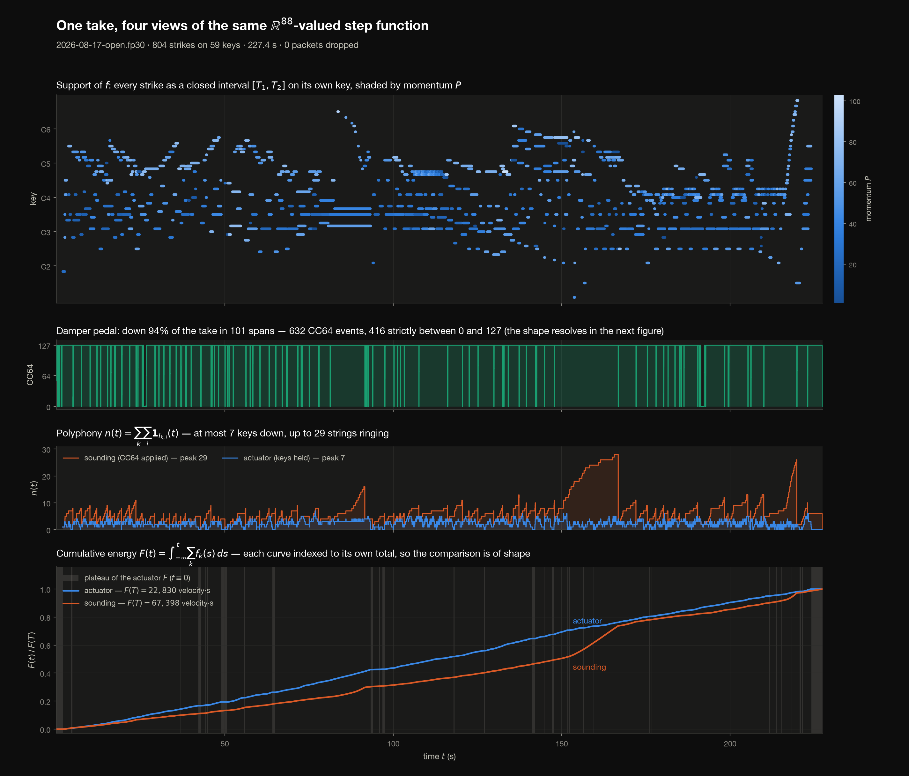

# FP-30X Studio

Capture what you play on a digital piano with driver-level MIDI timestamps, then treat the
take as a mathematical object: a step function `ℝ → ℝ⁸⁸` you can measure, align against a
score, resynthesise, splice and engrave. Built for a Roland FP-30X on macOS; most of it
works on any MIDI stream.



## Run it

```
./run.sh                               # the recorder app; creates its virtualenv on first run
make -C native                         # the native CoreMIDI capture tool
.venv/bin/python -m pytest tests/ -q   # 461 tests; the ones needing real takes or a corpus skip
```

Needs macOS, Python 3.10+ with tkinter, and `brew install fluid-synth` for rendering.
Pairing the piano is less obvious than it looks: [docs/connecting-the-piano.md](docs/connecting-the-piano.md).

## What's in it

| | Where | Read more |
| --- | --- | --- |
| Callback-driven CoreMIDI capture, bit-identical to the sender's timestamps on a synthetic source | `native/` | [capture-timing.md](docs/capture-timing.md) |
| A take as `⊕ₖ Σᵢ Pᵢ·1[T1ᵢ,T2ᵢ]`: total variation, polyphony, cumulative energy; an incremental index that accounts for every message | `performance.py`, `pipeline/` | [performance-and-pipeline.md](docs/performance-and-pipeline.md) |
| Live piece identification: transposition- and tempo-invariant interval n-grams over a theme corpus, ~19 ms CPU per tick | `identify/`, `idcorpus/` | [identify.md](docs/identify.md) |
| Least-energy homeomorphism between two performances; locating a take bar by bar in the Chopin nocturnes | `align/` | [VALIDATION-score-alignment.md](docs/VALIDATION-score-alignment.md) |
| A performance as the score plus a difference vector | `delta/` | module docstring |
| Sample-free synthesis; the `acoustic` preset is fitted to recorded Steinway notes | `synth/` | module docstring |
| Notation drawn from primitives, with no notation font or library | `viz/` | module docstring |
| Take-per-bar comping, stumble detection, pedal-aware excerpts, hand separation, transcription | `comp.py`, `stumbles.py`, `slicekit.py`, `hands.py`, `transcribe.py` | [HANDS-findings.md](docs/HANDS-findings.md) |
| An on-disk bundle format and its validator | `fpx/` | [SPEC-fpx-format.md](docs/SPEC-fpx-format.md) |

## Data not included

The theme corpus and the Chopin and Joplin scores live outside the repo. Point
`FP30X_CORPUS_DIR` at them (default `~/workspace/audio/corpus`) and build the index with
`python -m fp30x_studio.idcorpus.build`. `idcorpus/sources.py` lists each source and its
licence. Without them, identification falls back to a small built-in set.

## Not done yet

- Capture over the USB-B `COMPUTER` port. On real takes Apple's BLE-MIDI driver stamps
  every packet, but the Bluetooth link delivers on a 5 ms grid, so a chord arrives as a
  5 ms arpeggio ([analysis, §5](docs/take-2026-08-17.html)). Whether USB avoids the grid is
  untested.
- The GUI still records through the polling path; the native tool is a separate command.

The docs cite `JPA-n` issue numbers from a private tracker; they are not public.

MIT licensed. Much of this code was written with Claude, and those commits are authored as such.
