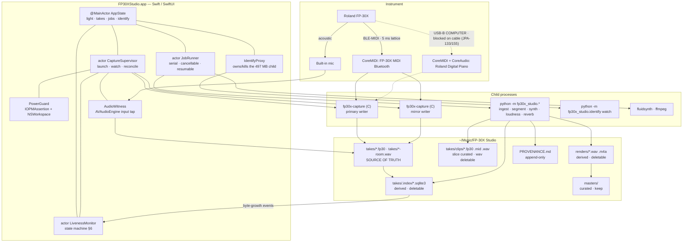
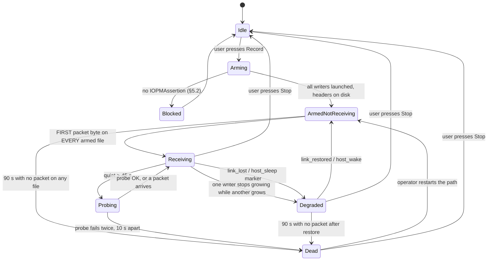

# FP-30X Studio — architectural design for a native macOS application

**Status:** design, not built. Written 2026-08-22.
**Brief:** *"it's time we release a desktop for macOS version of the fpx studio software. Write it
in some suitable coding language, give it the same features, and make sure it survives sleep …
distilling it down to a perfect software solution that suits my needs and doesn't need an LLM to
run everything for me."* — Jake, 2026-08-22 21:34:45, transcript `edf294c3`.

Four requirements are in that sentence: **macOS desktop**, **feature parity with the current
Python/C toolkit**, **survives sleep**, and **no agent in the loop**. The fourth is the one that
sets the architecture: every operational rule currently carried by
`~/.claude/skills/fp30x-recording/SKILL.md` — an instruction sheet for a language model — has to
become a mechanism in a program.

The sharper version of the same request came ten hours earlier, after a morning's playing was lost
(transcript `885ff9f8`, 2026-08-22 18:04Z):

> **"Under what conditions does recording of my keystrokes stop?"**

That is a request for the failure model, so that trusting the recording does not mean trusting an
agent's snapshot of it. §6.0 answers it exhaustively. The rest of the document is what the program
has to do about each row.

The guiding principle, which has survived the whole week and is worth stating before the design
(`885ff9f8`, 2026-08-21 23:41Z): **capture stupid simple raw data that tells it as it is, and do the
fancy stuff in the projection layer.** Nothing below rewrites a `.fp30`.

---

## 0. Decide from this page

### Recommendation

**A SwiftUI application, shipping the existing C capture binary as a supervised child process, and
the existing Python stack as a sidecar of cancellable subprocesses.** Rewrite nothing that works;
move into Swift only what has to be in-process to be correct — arming, the power assertion, the
sleep/wake observers, the liveness state machine, and job orchestration.

Verified today, on this machine: `SwiftUI`, `CoreMIDI`, `AVFAudio` and `AudioToolbox` are all
present in the Command Line Tools SDK 14.4, and `swiftc -parse-as-library` builds a SwiftUI +
CoreMIDI executable with **no Xcode installed** (`xcode-select` points at
`/Library/Developer/CommandLineTools`; `xcodebuild` errors out). So this recommendation is
buildable on the machine as it stands. Full argument in §2.

### The three hardest problems

1. **Proving liveness during silence.** Today's healthy 27.5-minute take
   (`~/Music/FP-30X Studio/takes/2026-08-22-home.fp30`) contains a **147.6-second gap between
   consecutive packets** — measured, §6.2. `watch.py` calls RED at 120 s and supervisor v3
   restarted at 120 s, so both would have fired on a perfect take. No silence threshold is honest.
   The FP-30X sends no Active Sensing (`0xFE` count is **0** across every take I checked), so there
   is no passive heartbeat either. Liveness during silence requires an **active out-of-band probe
   that does not exist yet** (§6.4).
2. **Representing the gap across a wake or a reconnect.** The capture can now reconnect
   (§4), which means a take file can contain a hole with music missing from it. Every downstream
   stage — segment, clip, stitch, identify, render — currently reads a hole as a musical rest. The
   hole has to be a first-class row in the data model and a hard boundary in the segmenter (§5.4,
   §8.3).
3. **Keeping exactly one parser for `.fp30`.** The "read only the first MIDI message of each
   CoreMIDI packet" bug has now been introduced **twice**: once in the analysis path, where it
   fabricated 157 orphan note-offs and a phantom 37.97 s note (JPA-137, retracted
   `PROJECT_LOG.md:314`); and again in the *export* path, where it silently dropped 5–9% of notes
   from every `.mid` — 135 of 1,930 on the 2026-08-21 nocturne — and reached a master already
   uploaded to Drive (JPA-149, fixed in `cc8a92d`). There are **still three independent parsers**
   in the tree today: `rawcapture.py:323`, `segment.py:220/234/262`, `stitch.py:79`. The design has
   to make a second parser impossible, not merely absent (§9.1).

### What I would build first

**Milestone 0 is the green light and nothing else.** A SwiftUI window whose entire content is one
large status light, a Record button, and a take name. It launches the existing
`native/build/fp30x-capture`, owns its own `IOPMAssertion`, observes `NSWorkspace` sleep/wake,
counts **packet bytes past the header** (not file size), and shows GREEN only when a real MIDI byte
has landed. That single milestone retires `greenlight`, the `caffeinate` ritual, and the arming
protocol in `SKILL.md` — which is where every minute of lost playing in this project has come from.
Milestone plan in §13.

### The riskiest assumption in this document

**That an out-of-band liveness probe exists at all.** §6.4 proposes two — `CBCentralManager
.retrieveConnectedPeripherals(withServices: [MIDI_SERVICE])` reporting the FP-30X while macOS holds
the connection, and a MIDI Device Inquiry SysEx round-trip to the `FP-30X MIDI Bluetooth`
destination. **I could not test either: the piano is off and unpaired right now**
(`fp30x-capture -l` → `no CoreMIDI sources present`, 2026-08-22 16:39). If both fail, the state
machine in §6 loses its `dead` transition and degrades to "GREEN, quiet for N minutes", which is
honest but weaker than what is designed here. This is a one-hour experiment and it should be run
before Milestone 2 is scheduled.

---

## 1. Sources, and how to re-check them

Everything below is either read out of the tree, measured by a command I ran today, or cited to a
transcript or Linear issue. Where I am guessing I say **GUESS** in-line.

| Source | What it is |
| --- | --- |
| `~/workspace/audio/fp30x-studio/` | The current package: 49 modules, 16,567 lines of Python, 538 lines of C. `git remote` = `github.com/mazerakham/fp30x-studio`. |
| `~/workspace/audio/PROJECT_LOG.md` | 62,656 B narrative, 2026-08-16 → 2026-08-22. |
| `~/Music/FP-30X Studio/takes/PROVENANCE.md` | Capture provenance, appended automatically by `pipeline/provenance.py`. |
| `~/.claude/skills/fp30x-recording/SKILL.md` | The operational rules. Each names the take it cost. Treated here as the reliability requirements document. |
| `~/.claude/skills/fp30x-recording/bin/{greenlight,postprocess}` | Written 2026-08-22. The arming signal and the unattended pipeline. |
| Transcripts `885ff9f8`, `50ec5096`, `b8a2bca6`, `edf294c3` | Prior Claude Code sessions in `~/.claude/projects/-Users-jake-workspace/`. |
| Linear `JPA-118/124/125/129/130/133/134/136/137/138/139/147/148/149/150/151/154/155/156/157/158` | Team `jake-personal-assistant`. |

Measurements I made today, reproducible:

| Measurement | Command | Result |
| --- | --- | --- |
| Corpus size | `python -m fp30x_studio.identify corpus` | 122,847 themes, 176,012 indexed hashes, 42 stop-hashes |
| Corpus cost | inline script, §11 | load 1.24 s, index 3.38 s, **497 MB RSS** |
| Identify cost | `python -m fp30x_studio.identify cost 2026-08-22-home.fp30` | 550 ticks @3 s, 7,336.9 ms CPU, **13.34 ms/tick, 0.4447% of one core** |
| Ingest throughput | `python -m fp30x_studio.pipeline ingest 2026-08-22-home-mirror.fp30` | 408,344 B / 15,920 packets / 17,032 messages / 6,799 intervals in **0.29 s**; index 3,633,152 B |
| Mirror fidelity | `grep -v '^#' … \| md5` on both writers | identical `dc3ec22b3dea0e157c98dc4fec1468bc`, 15,930 lines each |
| Gap distribution | inline script, §6.2 | median 35.0 ms, p95 365 ms, **max 147.6 s**; 15,897/15,920 on the 5 ms lattice |
| Active Sensing | `grep -c ' FE'` over three takes | **0** in all |
| Audio witness level | inline script, §7.3 | 1,464.3 s mono 48 kHz; first 60 s peak −18.67 dBFS, **RMS −45.68 dBFS** |
| Green-light false positive | live reproduction, §6.5 | `greenlight` flips GREEN on a `# setup_changed` comment line with **0 packets** in the file |
| Toolchain | `swiftc`, `sw_vers`, `sysctl` | macOS 14.4.1, Apple M3, 8 cores, **8 GB RAM**, Swift 5.10 CLT, no Xcode, no Rust, Node 26.7.0, FluidSynth 2.6.0, Python 3.14.7 |

### 1.1 Three places the record contradicts itself. The code wins.

- **`SKILL.md` says the capture cannot reconnect. It can, as of today.** The skill still reads
  *"`native/fp30x_capture.c` calls `MIDIClientCreate(..., NULL, NULL, &client)` — a null notify
  proc … The real fix is a `MIDINotifyProc` reconnecting on `kMIDIMsgSetupChanged`; until that
  lands, a drop needs a restart."* That fix **landed today**: `native/fp30x_capture.c` now passes
  `midi_notify` to `MIDIClientCreate`, reconnects on `kMIDIMsgSetupChanged`, and holds an
  `IOPMAssertion`. The brief for this document repeats the stale claim. **The code wins** — the
  source and `build/fp30x-capture` are both stamped 13:08 today and `strings` on the binary shows
  `# setup_changed reconnected %d`, so the fixed binary is what recorded the 16:00 take.
  **But it is uncommitted**: `git status` shows ` M native/fp30x_capture.c` (+91 lines) and
  ` M native/Makefile` (+`-framework IOKit`) against `cc8a92d`, which is level with `origin/main`.
  Per the working agreements, uncommitted work does not exist. **Commit this before building
  anything on top of it.**
- **README says 254 tests. There are 319.** `pytest --collect-only` → `319 tests collected`.
  Code wins.
- **`2026-08-19-usb.fp30` is not a USB take.** Its own header says
  `# source FP-30X MIDI Bluetooth`. JPA-133 is still blocked on the cable. The filename is the lie;
  the header is the truth. This is a direct argument for §8: **the capture path belongs in the file
  header and on screen, never in the filename.**

---

## 2. Language and framework

### 2.1 What the app actually has to do

| Job | API surface | Language pressure |
| --- | --- | --- |
| Receive MIDI on CoreMIDI's real-time thread | `MIDIInputPortCreateWithBlock`, `MIDIPacketList` | No allocation, no locks, no I/O on the callback. Favours C. |
| Learn the setup changed | `MIDINotifyProc` / `kMIDIMsgSetupChanged` | Any language with C interop. |
| Hold sleep off | `IOPMAssertionCreateWithName` (IOKit) | Any language with C interop. |
| See sleep and wake | `NSWorkspace.shared.notificationCenter` | Cocoa. Swift or Objective-C natively; everything else through a bridge. |
| Record a room mic | `AVAudioEngine` input tap, or `ffmpeg -f avfoundation` | Swift natively; subprocess otherwise. |
| Draw a status light and a take list | AppKit / SwiftUI | — |
| ℝ⁸⁸ step-function analysis, FFT reverb, physical-model synthesis, 122k-theme retrieval | numpy, sqlite3, existing 16.5k lines | Rewriting this is the whole cost. |

The last row is decisive. `performance.py` (940 lines), `take_analysis.py` (1,780), `align/`
(2,070), `synth/` (2,215), `identify/` (1,719), `idcorpus/` (2,191) are working, tested code with
319 tests behind them. None of it is on a latency path. Any plan that rewrites it is a plan to
spend months reproducing measurements that are already in `PROVENANCE.md`.

### 2.2 The four candidates, costed

**Swift + SwiftUI + CoreMIDI + AVAudioEngine.**
*Buys:* zero-bridge access to every macOS API in the table — CoreMIDI, IOKit, NSWorkspace,
AVFoundation, CoreBluetooth. A real app bundle, a real menu bar, a real Dock icon, real
notifications. Structured concurrency (`actor`, `AsyncStream`) maps cleanly onto "one supervisor,
N writers, a job queue". Verified buildable here without Xcode (§0).
*Costs:* Swift is a poor fit for the CoreMIDI read callback — ARC retain/release and exclusivity
checks are not documented as allocation-free, and the callback rule (no malloc, no locks, no
syscalls) is real-time-audio practice the current C file already honours deliberately
(`fp30x_capture.c` header comment, and it is honest that Apple's headers contain no verbatim
prohibition). Swift also cannot host numpy. So this is not "rewrite in Swift"; it is "Swift shell
around two existing runtimes", and the seams between them are the design work.
*Second cost, stated plainly:* nobody in the loop has shipped a signed, notarised macOS app in this
project. Without Xcode there is no `xcodebuild archive`; the bundle, `Info.plist`, entitlements and
`codesign` invocation have to be assembled by hand in a `Makefile`. That is a day, not a week, and
it is a day nobody has spent. **GUESS:** I believe an ad-hoc-signed local bundle needs no
notarisation for Jake's own machine; I did not test whether Gatekeeper's quarantine attribute
interferes when the bundle is built locally rather than downloaded. It should not — quarantine is
set by the downloader, not the compiler.

**Rust + a GUI toolkit (egui / Tauri / gtk-rs).**
*Buys:* a good real-time story — `no_std`-style discipline in the callback is natural, and
`coremidi`/`core-foundation` crates exist.
*Costs:* **Rust is not installed on this machine** (`rustc: command not found`), so it starts with
a toolchain install. Every Cocoa API in the table reaches Rust through `objc2`/`cocoa` bindings
that are third-party, version-skewed, and — for `NSWorkspace` sleep notifications and
`IOPMAssertion` — thin enough that you write the `extern "C"` declarations yourself. You end up
maintaining a private Cocoa binding layer for a single-user app. egui gives you an immediate-mode
canvas, not a macOS app; Tauri gives you a webview, which is Electron's cost with Rust's build
times. **Rejected**: it buys real-time rigour in the one place that is already 538 lines of proven
C, and pays for it everywhere else.

**Electron.**
*Buys:* the fastest path to a good-looking UI, and this project already produces excellent
self-contained HTML (`docs/timbre-workbench.html`, 167 KB). Node 26.7.0 is installed.
*Costs:* three fatal ones. (a) **Memory.** The machine has 8 GB. The identifier alone is 497 MB
resident (§11). A modern Electron shell is 300–600 MB before you draw anything. (b) **No CoreMIDI,
no IOKit, no NSWorkspace** without a native addon — so you write the C anyway, plus an N-API
binding, plus the JS on the other side; three languages to hold one assertion. (c) **The timer
problem is already documented in this project.** JPA-139 records the timbre workbench's
`setInterval` throttling to ~1 s when the tab was hidden, past the 0.25 s lookahead, causing ~7
dropped voices/second until the lookahead was made adaptive. A liveness light whose clock stops
when the window is backgrounded is the exact failure this application exists to prevent.
**Rejected.**

**Keep Python; wrap it in a native shell (py2app / PyInstaller / a thin Swift launcher).**
*Buys:* zero rewrite. Everything works on day one.
*Costs:* the shell still cannot own the assertion or the sleep notifications without a native
component, so you are back to a Swift or ObjC layer — at which point the question is only how much
of the app lives above the line. And the *existing* Python GUI is direct evidence against Tk:
`fp30x_studio/app.py` had to rebuild every button out of `tk.Label` because **macOS Tk silently
ignores `-background` on `tk.Button`**, and shipped with two buttons both reading "Stop" because
`start_record()` never reset the Play label (transcript `b8a2bca6`, 20:09, Jake's first UI defect
report: *"the button font is bad as you get a light-grey-on-white when I'm playing. And also I
think there are two stop buttons"*). A framework that silently discards the colour you set is a bad
substrate for a program whose central widget is a coloured light.

### 2.3 The recommendation, and where the line sits

```
┌──────────────────────────────────────────────────────────┐
│  Swift / SwiftUI          FP30XStudio.app                │  ← rewrite
│  arming, power, sleep/wake, liveness, jobs, UI           │
├──────────────────────────────────────────────────────────┤
│  C                        fp30x-capture (unchanged)      │  ← keep
│  CoreMIDI callback, lock-free ring, .fp30 writer         │
├──────────────────────────────────────────────────────────┤
│  Python 3.14 + numpy      fp30x_studio.* (unchanged)     │  ← keep
│  ingest, segment, identify, synth, loudness, reverb      │
└──────────────────────────────────────────────────────────┘
```

Three rules define the line:

1. **Anything whose lifetime must equal "armed" lives in Swift, in the app process.** The power
   assertion, the sleep observers, the liveness state. A child process that holds the assertion can
   exit; a `caffeinate` that holds it *did* exit, 55 seconds before the 09:50:18 sleep on
   2026-08-22 that swallowed several pieces (recorded in the `hold_awake()` comment in
   `fp30x_capture.c`). The app holds its own, and the capture keeps holding its own too — belt and
   braces cost nothing.
2. **Anything on CoreMIDI's real-time thread stays in C.** `fp30x_capture.c` is 538 lines, has
   measured bit-identical timestamp fidelity against a synthetic source (JPA-129: 0.0000 ms median
   error at all six spacings, 1,200/1,200 messages), and its hot path is auditable in one screen.
   Rewriting it in Swift buys nothing and risks a retain on the audio thread.
3. **Anything that is arithmetic over a finished file stays in Python.** It is not on a deadline,
   it is tested, and it is where all the measurements live.

The consequence is that **`fp30x-capture` stays a separate process, not a Swift class.** That is
deliberate: it means force-quitting the UI, or the UI crashing, does not stop a take. The property
that has actually saved recordings in this project is that the capture is a small boring process
appending to a file that can be `stat`-ed by anything. Keep it.

---

## 3. Component architecture



### 3.1 Threads and actors, concretely

| Owner | Isolation | Never does |
| --- | --- | --- |
| `AppState` | `@MainActor`, `ObservableObject` | blocking I/O, `Process.waitUntilExit`, decoding audio |
| `CaptureSupervisor` | `actor` | touch UI directly; it publishes via `AsyncStream<CaptureEvent>` |
| `LivenessMonitor` | `actor` | poll `pgrep`, list CoreMIDI sources, or read a packet counter (§6.1) |
| `JobRunner` | `actor`, serial | run two stages of one take concurrently; play audio |
| `PowerGuard` | `@MainActor` (Cocoa notifications are main-thread) | release the assertion before every writer has stopped |
| `AudioWitness` | AVAudioEngine's own render thread + a writer queue | allocate in the tap block |
| capture children | separate processes | anything else — they append and fsync |

The one piece of shared mutable state is the set of open takes, and it lives in the supervisor. UI
reads it through `AsyncStream`; nothing else writes it.

---

## 4. The capture engine

### 4.1 What is already correct

`native/fp30x_capture.c` as it stands today (uncommitted, §1.1):

- `MIDIInputPortCreateWithBlock` on the soft-deprecated `MIDIPacketList` API **on purpose** —
  MIDI 1.0 bytes with no UMP repacking between the driver and the file. Both APIs carry the same
  `MIDITimeStamp`, so nothing is given up on timing (JPA-129).
- Callback does exactly: read `timeStamp` (substituting `mach_absolute_time()` and counting
  `ts_zero` when it is 0, which is documented to mean "now"), `memcpy` ≤256 B into a preallocated
  slot of a 16,384-slot SPSC ring, bump an atomic. No malloc, no lock, no syscall.
- Writer thread drains, formats `<abs_ns> <HEX …>`, `write()`s, `fsync`s every 0.25 s.
- `midi_notify` on `kMIDIMsgSetupChanged` → `connect_sources()` (idempotent; reconnecting an
  already-connected source is harmless) → writes `# setup_changed reconnected N` and fsyncs.
- `hold_awake()` / `release_awake()` around the whole capture.

That is the right design. Keep it. The remaining work is in what the app does *around* it.

### 4.2 Reconnect policy — what is missing

Three gaps in the current `midi_notify`:

1. **It reconnects, but does not record what it lost.** The marker says how many sources were
   reconnected, not when delivery stopped. The take file has no way to express "music happened here
   and we did not receive it". Fix: on `kMIDIMsgSetupChanged`, write **two** lines —
   `# link_lost <unix_ns> <last_packet_ns>` when the matching source count drops to zero, and
   `# link_restored <unix_ns> reconnected <n>` when it comes back. The pair delimits a gap of known
   wall-clock extent.
2. **It fires on every setup change, including irrelevant ones.** Plugging in a USB audio interface
   fires `kMIDIMsgSetupChanged` too. Reconnecting is idempotent so this is harmless, but the marker
   is noise, and — critically — **a comment line is bytes on disk, which is what the green light
   counts** (§6.5). Fix: only write a marker when the set of connected matching endpoints actually
   changed. Track `MIDIObjectRef` + `kMIDIPropertyUniqueID` of connected sources and diff.
3. **No backoff, no ceiling.** If the radio flaps, `connect_sources()` runs on every notification.
   Fix: coalesce notifications on a 250 ms timer, and after 10 failed reconnects in 60 s escalate to
   the app (which is the thing that can tell Jake). **A capture process must never restart itself** —
   supervisor v1/v2/v3 all failed (`SKILL.md`), and v3 in particular littered empty takes. Restart
   policy belongs in the app, keyed on bytes, and it must reuse the same output file (the format is
   append-only, so a restart appends a fresh header block into the same take — which is why the
   reader must treat headers as a sequence, §8.2).

### 4.3 What the app does with the gap

The app owns the interpretation. On seeing `# link_lost`:

- Transition the light to `DEGRADED` immediately (§6).
- Record a `Gap(startNs, endNs, cause: .setupChanged)` in the index.
- On `# link_restored`, do **not** go back to GREEN. Go to `armedNotReceiving`, because the BLE link
  starts delivering somewhere between 0 and 40 seconds after CoreMIDI reports the source connected —
  on 2026-08-21 the file was created at 18:14:04 and the first byte landed at 18:14:31, twenty-seven
  seconds of playing recorded nowhere, and the take opened with four orphan note-offs (`SKILL.md`;
  this is also why `stitch.py` exists). Only a real packet returns the light to GREEN.
- Leave the gap in the take. Do not stitch automatically. `stitch.py` already does a defensible
  splice — 4-grams of pitch from the body's opening voting for an alignment offset in the head, and
  refusing when no offset dominates — but that is an *edit*, and edits are Jake's call, made
  knowingly, on a named artifact (§8.4). It works: on the two half-nocturnes of 2026-08-21 the votes
  produced a clean peak at **45.1 s**, corroborated structurally because the body's four orphan
  note-offs are E5/G♯4/E4/C♯4 — exactly the pitches of the head's chord at 45.08–45.12 s. The takes
  overlap to the resolution of a single chord, and his verdict was *"The seam came back
  indetectable. We got it."* Two refinements are in the code and must survive the port: anchor the
  body on its first **note-on**, not its first raw message (which is an orphan note-off 0.510 s
  earlier and became dead air), and cut the head late enough that its chord still rings so the
  body's own orphan note-offs release it.

### 4.4 Swift interface

```swift
struct CaptureSpec: Sendable {
    var outputURL: URL              // …/takes/2026-08-22-home.fp30
    var sourceMatch: String         // "FP-30X"  → -s
    var fsyncInterval: Double = 0.25
    var role: Role                  // .primary | .mirror(index: Int)
}

enum CaptureEvent: Sendable {
    case launched(pid: pid_t, headerBytes: Int)
    case grew(packetBytes: Int, atMachNs: UInt64)   // packet bytes only, never comments
    case marker(Marker)                             // .linkLost, .linkRestored, .hostSleep, .hostWake
    case exited(status: Int32)
}

actor CaptureSupervisor {
    func arm(_ specs: [CaptureSpec]) async throws -> AsyncStream<CaptureEvent>
    func disarm() async                              // SIGTERM, wait for `# end`, then release
}
```

Byte-growth events come from `DispatchSource.makeFileSystemObjectSource(fileDescriptor:eventMask:
[.write, .extend], queue:)` on each take file — event-driven, no polling — with a 1 s watchdog timer
as a backstop in case kqueue coalesces an event away. The supervisor holds its own read `fd` at the
last consumed offset and parses only the appended bytes, through **the one parser** (§9.1), so it
knows the difference between a comment line and a packet line. That distinction is the whole green
light.

---

## 5. Surviving sleep

This is the named requirement and it is where a take was lost most recently. The timeline was
reconstructed exactly from `pmset -g log` (transcript `885ff9f8`, 2026-08-22 18:01–18:06Z):

```
09:49:23  caffeinate exits — the process holding PreventUserIdleSystemSleep
09:49:48  display off
09:50:10  last captured MIDI byte
09:50:12  bluetoothd releases its own PreventUserIdleSystemSleep
09:50:18  "Entering Sleep state due to 'Idle Sleep'"
          → capture stays alive and deaf; nothing reconnects on wake
```

**Cost: about three hours and multiple pieces; 1 min 54 s and 179 notes survived.** The surviving
evidence on disk matches: `2026-08-22-a.fp30` is 12,775 B (last written 09:48) and
`2026-08-22-b.fp30` is **485 B — smaller than the header the tool writes**, i.e. a stub.

Two things in that log are load-bearing for the design. First, **the assertion was being held by
accident, by two processes that had their own reasons** — `caffeinate` (started by hand) and
`bluetoothd` (incidental) — and the take died in the 6-second window after the second one let go.
Second, the verdict from the same session, which is the clearest statement of what the green light
can and cannot mean: *"You had a green light and it was real at 09:50, and that's precisely the
problem… The green light proved the link was delivering at that moment. It proved nothing about the
next three hours."*

### 5.1 Assertions: what each one actually prevents

| Assertion | Prevents | Does **not** prevent |
| --- | --- | --- |
| `kIOPMAssertionTypePreventUserIdleSystemSleep` | idle system sleep | lid close; menu → Sleep; low battery |
| `kIOPMAssertionTypePreventUserIdleDisplaySleep` | display dimming/sleep | anything else |
| `kIOPMAssertionTypePreventSystemSleep` | system sleep **while on AC** | sleep on battery; lid close |

`caffeinate -dimsu` takes the first three plus `UserIsActive`. `pmset -g assertions` right now shows
exactly that: pid 73500 (`caffeinate`) holding `PreventUserIdleSystemSleep`,
`PreventUserIdleDisplaySleep` and `PreventSystemSleep`, "asserting forever".

**No assertion prevents a lid-close sleep on battery.** The app must therefore *survive* sleep, not
only prevent it. Prevention is the first line; the marker-and-gap machinery in §5.4 is the second,
and it is the one that has to be right.

> **GUESS, marked:** I state the AC-only restriction on `PreventSystemSleep` from Apple's
> `IOPMLib.h` documentation and the `caffeinate(8)` man page's description of `-s` ("valid only when
> system is running on AC power"). I did not test a lid close on battery with an assertion held —
> doing so requires deliberately risking a take, which is the wrong experiment to run on this
> project.

### 5.2 The app takes both assertions, and refuses to arm without them

`PowerGuard.arm()` calls `IOPMAssertionCreateWithName` twice —
`PreventUserIdleSystemSleep` (the take) and `PreventUserIdleDisplaySleep` (so the green light stays
on the screen he is glancing at). Both are released in `disarm()`, and in a `deinit`, and by an
`atexit` handler.

**Should the app refuse to arm without an assertion? Yes — refuse.** The argument: the green light's
whole meaning is "your playing is being recorded". On a machine that can idle-sleep, that claim has
a 30-minute fuse on it and no way to tell the player. The failure mode of
`IOPMAssertionCreateWithName` on a healthy Mac is essentially never, so the refusal costs nothing in
practice and removes an entire class of silent loss.

The escape hatch is explicit and self-documenting: a Preferences toggle *"Allow the machine to
sleep while recording"*, off by default, which when on writes `# sleep_allowed 1` into every take
header. If a take turns up short and the header says that, the reason is in the file.

The capture children keep their own assertions too (`hold_awake()` in `fp30x_capture.c`). Duplicate
assertions are free and the redundancy is the point: neither the app nor a child can be the single
process whose exit un-pins the machine.

### 5.3 Sleep and wake notifications

```swift
let nc = NSWorkspace.shared.notificationCenter
nc.addObserver(forName: NSWorkspace.willSleepNotification,      …)  // system is going down
nc.addObserver(forName: NSWorkspace.didWakeNotification,        …)
nc.addObserver(forName: NSWorkspace.screensDidSleepNotification,…)  // display only — informational
nc.addObserver(forName: NSWorkspace.screensDidWakeNotification, …)
```

`willSleepNotification` is delivered synchronously and macOS waits (briefly) for observers to
return, so the handler must be short and must not `await`. It does exactly three things:

1. Write `# host_sleep <unix_ns>` into every open take, via a pre-opened fd and a preformatted
   buffer, then `fsync`. (The capture children each fsync every 0.25 s independently; this marker is
   the app's, and it goes in through the same append-only fd so the ordering is the kernel's.)
2. Snapshot the last packet `ns` per take, in memory.
3. Set the liveness state to `sleeping`.

`didWakeNotification` writes `# host_wake <unix_ns>`, transitions to `armedNotReceiving`, and starts
a 60-second reconnect window. **Display sleep is not a capture event** — MIDI keeps arriving with
the screen off. It only matters because the green light is invisible, which is why the display
assertion is taken.

### 5.4 What a wake does to the take

The take is **one file**. It is not split, and the pieces are not silently joined.

Between `# host_sleep` and the first packet after `# host_wake` there is a gap of known wall-clock
extent and unknown musical content. That becomes a row:

```sql
CREATE TABLE gap (
    id          INTEGER PRIMARY KEY,
    start_ns    INTEGER NOT NULL,   -- mach ns of last packet before
    end_ns      INTEGER NOT NULL,   -- mach ns of first packet after
    wall_start  INTEGER,            -- unix ns from the marker, when present
    wall_end    INTEGER,
    cause       TEXT NOT NULL,      -- host_sleep | setup_changed | capture_restart | unknown
    keys_down   TEXT NOT NULL       -- JSON: pairer state at start_ns
);
```

Consequences that must be enforced, not documented:

- **`segment list` treats a gap as a hard boundary**, whatever its duration. A 40 s musical silence
  and a 40 s hole look identical in the packet stream and are not the same thing.
- **Notes held across a gap are closed at `start_ns` with `closure='gap'`.** The existing pairing
  layer already records *which observation closed each interval* and only counts
  `closure='note_off'` as a measured release (JPA-136); `gap` slots straight into that vocabulary
  and inherits the honesty.
- **Any clip, render or master whose span intersects a gap carries `GAP` in its filename** and a
  line in `PROVENANCE.md`. This is the same rule that produced FULL / COMPLETE / SEGMENT after a
  3:22 fragment was nearly published as a complete nocturne.
- **A take containing a gap can never be labelled COMPLETE by the automatic namer** in
  `postprocess`.

---

## 6. Liveness and the green light

### 6.0 Under what conditions does recording stop?

His question, answered completely. Every row is an observed failure, not a hypothetical.

| # | Recording stops when… | Observable at the time? | What the app does |
| --- | --- | --- | --- |
| 1 | the machine idle-sleeps | **no** — process alive, counters clean, source still listed | §5.2 refuses to arm without both assertions; §5.3 markers; §5.4 gap |
| 2 | the lid closes on battery | **no** — no assertion prevents it | cannot prevent; marks the gap (§5.4) and never labels the take COMPLETE |
| 3 | the BLE link drops (radio glitch, range, interference) | **no** | `kMIDIMsgSetupChanged` → reconnect (§4.2) → `Degraded` → gap |
| 4 | the piano's Auto Off fires (factory default 30 min) | **no** — the pairing outlives the instrument, so CoreMIDI keeps listing it | probe (§6.4), then `Dead` |
| 5 | the piano is switched off or moved out of range | **no**, same reason | probe, then `Dead` |
| 6 | the capture was armed but BLE has not started delivering yet (0–40 s) | yes, if you look at bytes; **no**, if you look at the connect line | `ArmedNotReceiving` is a distinct RED state; GREEN needs a real packet (§6.3) |
| 7 | the capture process dies (crash, OOM, kill) | yes — bytes stop on that path only | mirror writer keeps going; `Degraded(path:)`; app restarts into the same file |
| 8 | the disk fills or the fd goes bad | yes, per path | same as 7 |
| 9 | **the monitor itself breaks the link it is monitoring** | no | see below — the monitor is forbidden from touching CoreMIDI |
| 10 | nothing is wrong and he simply stopped playing for 147 seconds | indistinguishable from 3/4/5 without a probe | §6.2 — there is no silence threshold that separates these |

Row 9 is real and it is the reason for a hard architectural rule. The first watchdog probed liveness
by running `fp30x-capture -l` every ten seconds, **spinning up a fresh CoreMIDI client on each
probe**; one probe transiently failed to enumerate and raised a false alarm mid-performance
(`885ff9f8`, 2026-08-21 01:48Z: *"the monitoring interfering with the thing it was monitoring, and
worse, it was doing that repeatedly while you played"*).

> **Rule: `LivenessMonitor` may not create a `MIDIClientRef`, may not call `MIDIGetNumberOfSources`,
> and may not spawn a process.** It reads bytes off a file descriptor it already holds. That is its
> entire capability set, and §12 row 3 is the test that keeps it that way.

### 6.1 The contract

> **The light is GREEN if and only if a MIDI packet byte has been appended to every armed take file
> within the liveness window, or a liveness probe has succeeded within it.**
>
> Nothing else may turn it green. Not a live process, not a packet counter, not a CoreMIDI source
> listing, not a comment line, not a file that merely exists.

Each of those exclusions is a take that was lost:

| Liar | Why it lies | Cost |
| --- | --- | --- |
| the capture process | it does not exit when the link drops; it stays alive and deaf | the design of supervisor v1 |
| `packets/dropped` counter | `dropped` counts packets CoreMIDI handed us and our ring refused; a message lost on the radio never reaches CoreMIDI and is invisible **by construction** (JPA-137) | 2026-08-20 20:47:33–20:59 CT — a true alarm dismissed because the file was still growing with 249 notes that had arrived *before* the drop. **11 minutes.** *"I read stale data as proof of life and told you to keep playing."* |
| a fresh CoreMIDI enumeration used as a probe | creates a client per probe and can transiently fail to enumerate — the monitor breaking the link it monitors (§6.0 row 9) | a false alarm raised repeatedly mid-performance, 2026-08-21 |
| `fp30x-capture -l` | the source stays listed after the link is dead; the BLE pairing outlives the instrument | supervisor v2 fooled, 2026-08-21 — **6 minutes of a nocturne** |
| `connected: FP-30X MIDI Bluetooth` | CoreMIDI matches the source immediately; BLE delivers 0–40 s later | 2026-08-21 18:14:04→18:14:31 — **27 s**, four orphan note-offs |
| file size | the header, and now the reconnect marker, are bytes | reproduced today, §6.5 |

`fp30x_studio/watch.py` gets this **half right and should not be ported as-is**. Its GREEN/AMBER
decision is keyed on file mtime, which is honest. But its RED conditions call `pgrep -f
"fp30x-capture -o"` and shell out to `fp30x-capture -l` — the two signals the skill names as liars —
and it runs a full `TakeStore.ingest()` on every 3-second refresh. In the app, the liveness monitor
must not be able to see those signals at all.

### 6.2 Why no silence timeout is honest

Measured on today's healthy, continuous, 27.5-minute take:

```
packets 15920   span_s 1649.8
gaps:  median 35.000 ms   p95 365.0 ms   max 147.6 s
on 5 ms lattice: 15897/15920 = 0.9986
  gaps >   2 s: 14      gaps >  20 s: 2
  gaps >   5 s:  6      gaps >  60 s: 1
  gaps >  10 s:  3      gaps > 120 s: 1
```

There is a **147.6-second gap between consecutive packets in a take with no drop in it** (zero
`setup_changed` markers in either the primary or the mirror). `watch.py`'s `RED_S = 120.0` would
have called that take dead. Supervisor v3 restarted on 2 minutes of no bytes and "cycles during long
pauses and litters empty files" — this is why, quantified.

So: **silence is not evidence of death, at any threshold.** The state machine must not have a
silence→dead edge. It has a silence→*probe* edge.

### 6.3 The state machine



| State | Light | What Jake sees | Driven by |
| --- | --- | --- | --- |
| `Idle` | grey | a Record button | — |
| `Arming` | **RED** "do not play yet" | one line | writers launched, headers fsynced |
| `ArmedNotReceiving` | **RED** "press one key" | one line | no packet byte yet on ≥1 armed file |
| `Receiving` | **GREEN** "RECORDING" | one word | packet bytes on **every** armed file |
| `Probing` | GREEN, dimmed | nothing extra | ≥45 s quiet; probe running |
| `Degraded` | **AMBER**, names the path | one line: which path, and that the rest are still up | writer stalled, or a marker |
| `Dead` | **RED** "not recording" | one line | probe failed twice, or 90 s after arm/restore |
| `Blocked` | **RED** "cannot hold sleep off" | one line | `IOPMAssertionCreateWithName` failed |

**The UI contract, from `SKILL.md` and from Jake directly** (transcript `edf294c3`, 21:03:37:
*"You're supposed to give me a green light, please put it in the skill and get it to not talk so god
damned much"*; and 21:02:51, typed and withdrawn but written: *"Why is this still so fucking
complex?"*):

- While armed, the window shows **the light and nothing else**. No path inventory, no counters, no
  caveats, no offers. Counters live behind a disclosure triangle that is closed by default and does
  not open itself.
- **Never ask for a second thing.** The arming ask is one test note. Not a cable, not a setting, not
  a decision. Anything else the app wants goes into a badge on the take list, seen later.
- **Report at the end.** The post-take summary appears when Stop is pressed, not during.
- The light is the only thing that may change appearance while GREEN. No spinners, no scrolling log.

### 6.4 The probe — the piece that does not exist yet

Two candidates, neither tested, because the piano is off (§0):

**(a) CoreBluetooth connection state.** `CBCentralManager.retrieveConnectedPeripherals(withServices:
[CBUUID(string: "03b80e5a-ede8-4b33-a751-6ce34ec4c700")])` returns peripherals connected **to the
system**, by any process — so the app can ask whether the BLE-MIDI peripheral is still connected
while macOS's own CoreMIDI driver holds the link. The service UUID is already known in-tree:
`~/workspace/audio/bt_midi.py` names it, along with the characteristic
`7772e5db-3868-4112-a1a9-f2669d106bf3` and the advertised name `FP-30X MIDI`.
*Cost:* triggers the Bluetooth privacy prompt (`NSBluetoothAlwaysUsageDescription`).
*Risk:* **GUESS** — I am inferring from the CoreBluetooth documentation that a peripheral connected
by another process is returned here. I did not verify it, and if it is not, this candidate is dead.

**(b) MIDI Device Inquiry SysEx round-trip.** Send `F0 7E 7F 06 01 F7` to the `FP-30X MIDI
Bluetooth` *destination* and look for an Identity Reply (`F0 7E … 06 02 …`) on the source within,
say, 2 s. Roland instruments generally answer this.
*Cost:* it puts bytes on the wire during a musical silence, and the reply lands in the take file,
where the parser must classify it (it will — `split_messages` already length-decodes SysEx, and the
pairing layer's role accounting has an `other` bucket).
*Risk:* **GUESS** — the FP-30X manual's MIDI implementation was not checked for Device Inquiry
support, and no take on disk contains an `F0` byte to confirm it round-trips.

**What to do about not knowing:** run the one-hour experiment before Milestone 2 — pair the piano,
try (a), try (b), record the result in `PROJECT_LOG.md`. If both fail, the `Probing` state collapses
into "GREEN, quiet for N minutes" with the minutes shown, and the app cannot distinguish a rest from
a dead radio — which is exactly the situation today, so nothing is lost, but the design should say
so out loud rather than assume the probe works.

### 6.5 The false green, reproduced today

`greenlight` (written 2026-08-22 16:04) baselines each file with `stat -f %z` and turns green on
**any** growth. The reconnect logging added to `fp30x_capture.c` the same morning writes
`# setup_changed reconnected N` into the take. Those two facts combine into a false green. Verified,
just now:

```
$ printf '# fp30x-capture v1\n' > fg.fp30
$ greenlight fg.fp30 &                      # RED
$ printf '# setup_changed reconnected 1\n' >> fg.fp30
  ● RED — do not play yet, press ONE key
  ● GREEN — RECORDING, GO
--- packet lines in file: 0 ---
```

Zero MIDI packets, green light. This is the exact class of bug the skill exists to prevent — a
healthy-looking signal over a dead link — reintroduced by the tool built to fix it, on the same day.

The same hazard exists at launch: `fp30x-capture` writes a ~554-byte header immediately, before any
MIDI byte, so a `greenlight` started concurrently with the capture (baseline 0) goes green on the
header. It behaves correctly only when started strictly after the header lands, which nothing
enforces.

**The fix is the contract in §6.1**: the monitor parses appended bytes and counts *packet lines*.
It is one line of extra work and it is not optional. `greenlight` should be rewritten to call the
app, or retired when the app ships.

### 6.6 The rest of the UI, from defects he reported

The light is what he asks for by name, repeatedly and across five days — *"You should have a green
light or a redlight at the end of your next message"* (`50ec5096`, 08-18); *"Just looking for a green
light"* (08-19); *"Hit me with a green light when you're certain it's working. I'll be playing test
notes waiting for your green signal"* (`885ff9f8`, 08-22); *"Green light me"* (08-22). Its ancestor
is the first request of all (`50ec5096`, 2026-08-17 20:57): *"Any chance you can peek at the results
while they are being generated? It is preferable to playing for an hour and finding out it's
garbage."*

Four more requirements come from defects he reported against the existing Tk app, and each is a
concrete acceptance criterion:

| His words | Requirement |
| --- | --- |
| *"FP-30X Studio doesn't seem to be working, it doesn't have any of my recordings / isn't autorefreshing / has no refresh button"* (`50ec5096`, 08-18 01:10) | The take list is **live**. It shows a take **while it is still being written** — duration, note count and light, updating from the same byte-growth stream as the liveness monitor. No refresh button, because there is nothing to refresh. |
| *"What is the command to run fpx studio? Run it please"* (`50ec5096`, 08-19 18:02) | A real `.app` in `/Applications`, launchable from Spotlight. There is no command. |
| *"Dragging the playback peg does not fast-forward, it snaps back to current position. No seeking is possible here"* (`885ff9f8`, 08-21 23:27) | Playback uses `AVPlayer` on a local file, so seeking is free. (The web-page failure behind that complaint was `python3 -m http.server` ignoring HTTP Range — see §12.) |
| *"Print it here with a purple light when you have it… I'll be playing piano and looking out for purple lights in my peripheral vision"* (`50ec5096`, 08-19) | The identify verdict is a **purple** indicator sized to be read peripherally, not a text panel. §11.4. |

---

## 7. Redundancy

### 7.1 Two writers on one radio — what it is worth, measured

Two `fp30x-capture` processes on the same CoreMIDI source, run today at 21:00:28 and 21:00:29 UTC:

```
408344 2026-08-22-home.fp30          15930 lines
408344 2026-08-22-home-mirror.fp30   15930 lines
packet lines md5, both: dc3ec22b3dea0e157c98dc4fec1468bc
first packet, both:     183827810000000 B0 40 16
```

Byte-identical bodies, identical mach timestamps. This is worth stating precisely because it cuts
both ways:

- **What it buys:** survival of a process crash, a writer thread wedging, an fd going bad, a disk
  hiccup on one file. Cheap — one more process, 400 KB, no measurable CPU.
- **What it does not buy:** anything about the radio. Both are downstream of one CoreMIDI client set
  and one BLE link. A drop is invisibly identical in both files. It also buys **no independent
  information for reconciliation** — the mirror can never fill a hole in the primary, because it has
  the same hole.

So mirroring is a cheap fault-tolerance measure and **not** a redundancy measure in the sense that
matters. Arm it by default (`Preferences → Mirror writers: 1`), and never let the UI imply that two
green paths mean the radio is safe.

**Design consequence:** the liveness monitor requires bytes on **every** armed file for GREEN, and
raises `Degraded(path:)` when one writer stalls while another grows — because that divergence is
precisely the fault the mirror exists to catch, and it is the only fault it can catch.

### 7.2 A genuinely independent MIDI path

`~/workspace/audio/bt_midi.py` is a userland BLE-MIDI GATT client (bleak/CoreBluetooth) that
bypasses CoreMIDI entirely. It is **not** a redundant path in practice: a BLE peripheral accepts one
central connection, and macOS's CoreMIDI BLE driver holds it. The README says as much — it is useful
"when the piano is unpaired and still advertising". Treat it as a *diagnostic*, not a writer.

The only genuinely independent MIDI path is USB (§7.4).

### 7.3 The audio witness

Armed today alongside the mirror: `ffmpeg -f avfoundation -i ":0"` from the built-in mic. Measured
by me on the resulting file:

```
~/Music/FP-30X Studio/takes/2026-08-22-home-room.wav
1 ch  48000 Hz  16 bit  1464.3 s  (140,576,846 B)
first 60 s:  peak −18.67 dBFS   rms −45.68 dBFS
```

RMS 25.7 dB below a usable −20 dBFS, which corroborates the skill's "about 25 dB below a usable
level" exactly. So:

- **What it is:** the only witness that survives the radio dying. Proof a take happened, and a
  wall-clock timeline to align the MIDI against.
- **What it is not:** audio. It must never be offered as a render, and the file browser must label
  it `witness` so it cannot be mistaken for one. (JPA-155 records that every `.wav` under `takes/`
  being a fluidsynth render "has already misled one agent" — the same trap, one directory up.)
- **In the app:** `AudioWitness` uses `AVAudioEngine`'s `inputNode.installTap` writing to
  `AVAudioFile` (CAF, 48 kHz mono, 16-bit), rather than shelling out to ffmpeg — it gives the app
  the input level for free, which is the one honest *audio* liveness signal available.
- **Do not let it hold the assertion.** Audio recording asserts `PreventUserIdleSystemSleep` as a
  side effect, and that side effect has been quietly saving takes (`SKILL.md`). The app takes its
  own assertion (§5.2) so that turning the witness off cannot silently arm the sleep timer.

### 7.4 The USB `COMPUTER` port

Status, from the record and confirmed today: the square USB-B `COMPUTER` port carries **"performance
data and audio signals" both** (owner's manual p. 5; `FP-30X-owners-manual-eng02.pdf` in
`~/workspace/audio/`). The FP-30X has **no** `USB Driver = GENERIC/VENDOR` setting — `grep -ci
driver` over the extracted manual returns 0, the Function-mode list on p. 12 is 14 settings and
contains no USB mode, and Roland ships no macOS driver for this model (JPA-133, `PROJECT_LOG.md`
:988). When it was last on the bus (2026-08-20) macOS enumerated it as `Roland Digital Piano`
(VID `0x0582`, PID `0x029c`) and left it **`!registered, !matched`** with zero interfaces — no
CoreMIDI port, no CoreAudio device. As of 16:39 today it is not on the bus at all
(`system_profiler SPUSBDataType` shows only the two host controllers). **Blocked on a
USB-C-to-USB-B cable and nothing else.** One untried step is on record: power-cycle the piano with
the cable already connected.

What the app does about it now, before the cable arrives:

- **Model the capture path as a first-class field, selected by endpoint name and recorded in the
  header** — `# path ble | usb | virtual` — and display it on the take row. Never encode it in the
  filename. `2026-08-19-usb.fp30` is a Bluetooth take with a USB name (§1.1) and that mistake must
  not be repeatable.
- When a `Roland Digital Piano` CoreMIDI source appears, the supervisor offers it as an **additional
  armed path**, not a replacement. When a matching CoreAudio device appears, the witness switches
  from the mic to it and stops being a witness — it becomes the instrument's own voice, which is the
  thing JPA-155 has been urgent about since 2026-08-19.
- The USB path also settles the open timing question: whether the 5.000 ms lattice
  (15,897/15,920 packets today) is the piano's 200 Hz key scan or BLE batching. If USB still shows
  5 ms, sub-5 ms timing does not exist on this instrument by any route and every timing question can
  be closed (JPA-133).

### 7.5 Reconciling paths

| Pair | Clock relationship | Reconciliation |
| --- | --- | --- |
| primary ↔ mirror (BLE) | identical `MIDITimeStamp`s, same driver | exact set union on `(ns, bytes)`. Verified: md5-identical today. Trivially correct. |
| BLE ↔ USB | both stamped by CoreMIDI drivers on the same host `mach_absolute_time` clock, but different lattices (5 ms vs unknown) | **GUESS:** union on `(note, kind)` within a ±3 ms window, preferring the USB timestamp as the finer one, and flagging any event present in one path and not the other as a `path_divergence` defect. This is the one reconciliation rule in this document that I cannot validate until the cable lands. Do not implement it speculatively — implement the *representation* (multiple paths per take) now, and the merge rule when there is data. |
| MIDI ↔ audio witness | different clocks entirely (mach vs the audio device's sample clock) | Do not merge. Align for *display* only, by anchoring the witness's start to `anchor_unix_ns` and letting the user nudge. The witness answers "did this happen", not "when exactly". |

**Reconciliation is never destructive.** Merged output is a new derived artifact
(`takes/merged/<name>.fp30`) with a header naming its inputs. The source takes are never rewritten.

---

## 8. Data model and on-disk format

### 8.1 What is true, what is derived, what is safe to delete

```
~/Music/FP-30X Studio/
├── takes/                                    ── SOURCE OF TRUTH
│   ├── 2026-08-22-home.fp30                  raw MIDI, append-only          KEEP FOREVER
│   ├── 2026-08-22-home-mirror.fp30           mirror writer                  KEEP FOREVER
│   ├── 2026-08-22-home-room.wav              audio witness                  KEEP FOREVER
│   ├── 2026-08-16 15.03.58.mid               legacy poll-loop takes (5)     KEEP FOREVER
│   ├── PROVENANCE.md                         append-only narrative          KEEP FOREVER
│   ├── labels.json                           human ground truth (JPA-151)   KEEP FOREVER
│   ├── .index/<take>.sqlite3                 materialised pairing           DERIVED · DELETABLE
│   └── clips/<name>.{fp30,mid,wav}           .fp30 slice + .mid  CURATED
│                                             .wav                           DERIVED · DELETABLE
├── renders/*.raw.wav                         pre-effects render             DERIVED · DELETABLE
├── renders/*.linear.hall.{wav,m4a}           finished render                DERIVED · DELETABLE
├── renders/PROVENANCE.md                                                    KEEP FOREVER
├── masters/*.{wav,flac,m4a,mp4}              hand-curated exports           CURATED · KEEP
├── MuseScore_General.sf3                     38 MB, auto-downloaded         DERIVED · DELETABLE
└── soundfonts/jRhodes3/jRhodes3c-stereo.sf2  user-supplied, NOT redistributable
```

The rule: **a take is irreplaceable — you cannot re-play a take** (JPA-158). Everything downstream
of it is a function of the take plus parameters, and the parameters are recorded, so everything
downstream is regenerable. The app's "Reclaim space" command may delete `.index/`, `clips/*.wav`,
`renders/*.raw.wav` and the soundfont, and may **never** offer to delete a `.fp30`, a `-room.wav`, a
`PROVENANCE.md`, `labels.json`, or anything in `masters/`.

Measured storage pressure, one 23m32s performance: `.fp30` 408 KB → index 3.6 MB → clip `.wav`
252 MB → two `raw.wav` 547 MB → two `hall.wav` 548 MB → two `.m4a` 94 MB. **≈1.4 GB of derived data
from 408 KB of truth.** With 41 GB free on this machine that is roughly 30 performances before it
matters, so the reclaim command is a real feature, not a nicety.

### 8.2 `.fp30` format changes

The format stays text, line-oriented, append-only, greppable. That is the right decision and it is
argued in the C header comment: MIDI's worst-case data rate is a few KB/s, so the encoding costs
nothing and buys `tail`, `grep`, `diff` and human readability. It is also why a torn write costs at
most one line.

Three changes:

1. **Comments become an ordered event list, not a dictionary.** `rawcapture._consume` folds every
   `# key rest` line into `out.header[key] = rest`, so *the last one wins* — a take with three
   `# setup_changed` lines reports one, and a restarted capture's second `# started_utc` silently
   overwrites the first. Today's reconnect logging is therefore invisible to every consumer.
   New shape:
   ```python
   @dataclass
   class RawEvent:
       byte_offset: int
       kind: str          # started | source | sources_connected | setup_changed
                          # | link_lost | link_restored | host_sleep | host_wake
                          # | sleep_allowed | path | clip_entry_cc | end
       fields: dict[str, str]
   ```
   `Scan.events: list[RawEvent]`, with `Scan.header` kept as a compatibility view over the first
   occurrence of each key. Existing files parse unchanged.
2. **New markers**, all optional and all ignorable by an old reader: `# path <ble|usb|virtual>`,
   `# link_lost <unix_ns> <last_packet_ns>`, `# link_restored <unix_ns> reconnected <n>`,
   `# host_sleep <unix_ns>`, `# host_wake <unix_ns>`, `# sleep_allowed 1`.
3. **Extension: accept both `.fp30` and `.fp30x`.** The README and `rawcapture.py` docstrings say
   `.fp30x`; every file on disk is `.fp30`. Reader accepts both; writer emits `.fp30`; docs get
   corrected.

### 8.3 Index schema: bump 1 → 2

`SCHEMA_VERSION = 1` in `pipeline/store.py`. Version 2 adds the `gap` table (§5.4), a `path` column
on `take`, and a `closure='gap'` value. Because the index is derived, migration is *deletion*: bump
the constant, and `TakeStore` re-ingests when it sees an older version. Measured cost of a full
re-ingest of the largest take on disk: **0.29 s**. There is no migration problem here, only the
discipline of never writing anything to `.index/` that is not recomputable.

The checkpoint design stays exactly as it is and should be treated as settled: byte offset +
`file_size` + `head_sha256` + pairer state, with a shrink-or-rewrite forcing a full re-ingest. It
was verified by replaying a real 353 s take as 17 uneven appends that cut lines mid-record and
getting a row-for-row identical index (JPA-136).

### 8.4 Migration: the existing files must keep working

| Artifact | What must not break |
| --- | --- |
| 5 poll-loop `.mid` takes from 2026-08-16 | still ingest; still marked `timing_grade='poll-loop'`; timing-sensitive queries still refuse to be quoted quietly against them |
| 18 `.fp30` takes | parse unchanged; no new required header key |
| 16 existing `.index/*.sqlite3` | detected as v1 and rebuilt automatically (0.29 s each) |
| `takes/clips/` incl. `clip_entry_cc` trailers | the chased-pedal trailer keeps its meaning; clips stay addressable against their parent by absolute timestamp |
| `takes/PROVENANCE.md`, `renders/PROVENANCE.md` | append-only; the app appends, never rewrites |
| `labels.json` (JPA-151) | preserved, including `revised_from` history |
| `masters/` | untouched, including the FULL / COMPLETE / SEGMENT naming |

A first-run migration pass records what it did in `takes/PROVENANCE.md` as one dated line, per the
house rule.

---

## 9. The processing pipeline as an object

Jake's own framing, 2026-08-22, quoted in `bin/postprocess`: *"This should all be an automated
pipeline that you can run in the background while continuing to talk to me."* The shell script is
the prototype. The app makes it an object.

### 9.1 One parser, structurally enforced

Before anything else: **delete the duplicate `.fp30` parsers.** `segment.py` (three sites) and
`stitch.py` each open the file and split lines themselves. That duplication is not incidental — it
is *why* the first-message-only bug came back in the export path after being fixed in the analysis
path, and it cost 135 of 1,930 notes on a master that had already been uploaded (JPA-149).

Enforcement, not documentation:

- `rawcapture.scan()` is the only function permitted to read a `.fp30` byte. Everything else takes a
  `Scan` or a `TakeStore`.
- A test greps the package for `open(` on a `.fp30` path outside `rawcapture.py` and fails. The
  identify package already has a test of exactly this shape — it greps the identification path for
  model and socket imports — so the pattern is established in-tree and known to work.
- The Swift side never parses `.fp30` for content. It counts packet lines for liveness (§4.4) using
  a 20-line reader whose *only* job is "is this line a comment"; it never decodes a MIDI byte.

### 9.2 Stages

```
ingest → segment → clip → identify → render → level → space → encode → publish
```

| Stage | Command today | Inputs | Outputs |
| --- | --- | --- | --- |
| `ingest` | `pipeline ingest` | `.fp30` | `.index/*.sqlite3` |
| `segment` | `segment list` | index | segment table (in memory) |
| `clip` | `segment clip --from … --no-play` | `.fp30` + index | `clips/<n>.{fp30,mid,wav}` |
| `identify` | `identify check` | `.fp30` | verdicts |
| `render` | `fluidsynth -ni -g <probed>` or `synth render -p <preset>` | `.mid` | `renders/<n>.<voice>.raw.wav` |
| `level` | `loudness --ratio 3 --pivot -20`, or linear | `.wav` | `.wav` |
| `space` | `reverb --wet 0.28 --rt60 2.1` | `.wav` | `.wav` |
| `encode` | `ffmpeg -c:a aac -b:a 256k` | `.wav` | `.m4a` |
| `publish` | `show --url` | `.m4a` | a URL |

### 9.3 The object

```swift
protocol Stage: Sendable {
    var id: StageID { get }
    var inputs: [URL] { get }
    var outputs: [URL] { get }
    /// SHA-256 over: input digests + serialised parameters + tool versions.
    func fingerprint() throws -> String
    func run(_ ctx: JobContext) async throws          // must honour ctx.cancellation
}

actor JobRunner {
    func enqueue(_ pipeline: Pipeline) -> JobID
    func cancel(_ id: JobID) async                    // SIGTERM child, delete *.part
    func progress(_ id: JobID) -> AsyncStream<StageProgress>
}
```

Four properties, each of which is a rule that has been broken:

- **Never blocks the UI.** Every stage is a `Process` on a background queue. Nothing calls
  `waitUntilExit()` on the main actor.
- **Never plays sound unasked.** Every invocation of `segment clip` passes `--no-play` (the default
  plays the result, and *"he is often at the keyboard and will tell you not to make sound"*). The
  app owns playback and starts it only from an explicit user action. This is enforced at the
  `Stage` layer, not left to each call site.
- **Resumable.** A stage whose outputs exist and whose `fingerprint()` matches the recorded one is
  skipped. Fingerprints go in `takes/.index/jobs.sqlite3` — derived, deletable.
- **Cancellable and atomic.** Every output is written to `<name>.part` and `rename(2)`d on success —
  the trick `core.ensure_soundfont` already uses for the 38 MB download. Cancellation SIGTERMs the
  child and unlinks the `.part`. A cancelled job never leaves a half-file that a later run mistakes
  for a completed output.

### 9.4 The pedal chase is part of the clip, not an option

`segment clip` reads all controller state before the window and writes it into the slice's trailer
as `clip_entry_cc` lines, then injects it at the head of the `.mid`. CC64 is held across bar lines
for tens of seconds — on the open take the pedal is down for 94% of the take across 101 spans — so a
clip cut mid-phrase without the chase renders dry. This is `Chase Events` in DAW terms and it is not
a checkbox. The `Stage` for `clip` has no parameter to turn it off.

### 9.5 Where `postprocess`'s heuristics need to become choices

The shell script picks the performance as *the longest segment*, by an `awk` over the `segment list`
output. That is a reasonable default and a bad contract — it is a text-scrape of a human-readable
table, and it silently picks something. In the app, `segment list` returns structured segments, the
longest is **preselected**, and the take view shows all of them so the choice is visible and one
click from being changed. Same default, no silence.

Likewise the automatic name `<take>-COMPLETE-<m>m<s>s`: the app must not write `COMPLETE` when the
chosen segment is not the whole take, or when the take contains a gap (§5.4). The naming rule
exists because a 3:22 fragment was nearly published as a complete nocturne, two files differing by
one word.

---

## 10. Rendering

### 10.1 Two engines, one protocol

```swift
protocol Renderer {
    var id: String { get }            // "fluidsynth.acoustic", "model.electric", …
    func render(midi: URL, to out: URL, sampleRate: Int) async throws -> RenderReport
}
```

**`FluidSynthRenderer`** — subprocess, FluidSynth 2.6.0, two soundfonts:
- acoustic: `~/Music/FP-30X Studio/MuseScore_General.sf3` (38 MB, MIT, auto-downloaded on first run)
- electric: `~/Music/FP-30X Studio/soundfonts/jRhodes3/jRhodes3c-stereo.sf2` — a 1977 Rhodes Mark I,
  five velocity layers. **Jake's stated preference is electric / linear gain / hall.**

**`ModelRenderer`** — `python -m fp30x_studio.synth render -p {acoustic,electric}`. Not a sampler:
every sample is computed from a written-down physical model (inharmonic stiff string $f_n = n f_0
\sqrt{1 + Bn^2}$ with per-partial decay; a tine/FM voice for the Rhodes). **15 of its coefficients
are fitted to 38 recorded notes of a 2001 Steinway B (University of Iowa); 7 remain guesses and are
labelled as such in the preset, the report JSON, and the page** (JPA-154). The UI must carry that
label — a preset with 7 guessed coefficients is not the same claim as a sampled instrument, and
`renders/PROVENANCE.md` already states plainly that "nobody in the loop that produced these files
can hear."

They coexist as peers in a **Voice** picker: `Acoustic (soundfont)`, `Electric (soundfont)`,
`Acoustic (model, 15/22 fitted)`, `Electric (model, unfitted)`. Same output contract, same post
chain, different `Renderer`.

**The acceptance bar for the model renderer is his ear, and it has failed twice.** *"The ones you
showed me earlier were a bit grating… Felt kind of metallic. Scraping my spine. You would have to be
human to get it."* (`50ec5096`, 2026-08-18 19:25.) *"The sound is extremely 8-bit, does not sound
anything like a cool electric piano or grand."* (2026-08-19 19:34, which is what triggered JPA-154's
fitting pass.) *"Can you give this the nice timbre instead of the 8-bit crap we made?"*
(`885ff9f8`, 2026-08-20.) Until the model passes that bar the **soundfont voices are the default**,
and the model voices are labelled with their fitted/guessed count so the choice is informed. This is
also why the pipeline must render *both* voices unattended, as `postprocess` already does: the only
way to settle it is to hand him an A/B.

The related defect, and it is not a timbre issue: *"sounds amazing but has no pedal so not very
legato"* and *"Needs pedal though … sounds horrible without it"* (`885ff9f8`, 2026-08-20). CC64 is
continuous half-damper on this instrument, not a switch; both renderers must consume the full
0–127 stream, and the clip stage must chase it (§9.4).

### 10.2 Gain — the settled facts, as code

```swift
// 1. Probe LOW. Probing at 1.0 clips on the electric piano, and a clipped probe
//    reports the clipping point rather than the signal, so the correction is
//    wrong in an unknown direction.
let probePeak = try await fluidsynth(gain: 0.1, midi: midi, to: tmp).peak()
guard probePeak > 1e-6 else { throw RenderError.probeProducedSilence }  // §12, incident 5
let gain = min(10.0, 0.1 * (0.89 / probePeak))
// 2. Take the headroom in the RENDER. fluidsynth's default gain is 0.2, which
//    leaves ~24 dB unused; the first render of the 2026-08-17 nocturne peaked at
//    −24.5 dBFS for exactly this reason. Amplifying a finished 16-bit file
//    instead lifts the quantisation noise with the music.
try await fluidsynth(gain: gain, midi: midi, to: out)
```

The probe is not a formality: on the same MIDI file, the electric soundfont needed **gain 0.34** and
the acoustic needed **2.12** — a factor of six between two timbres, which is the five velocity
layers of the Rhodes doing real work. A single hardcoded gain is wrong for one of them by 16 dB.
(`885ff9f8`, 2026-08-21; the same session shipped a clipped electric render at −0.0 dBFS whose
"linear" file was louder than its compressed one, because the probe had been run at unity.)

And the post chain:

- **Linear** (his preference): render → `reverb --wet 0.28 --rt60 2.1` → AAC 256k.
- **Compressed**: render → `loudness --ratio 3 --pivot -20` → reverb → AAC.
  The mapping is $\mathrm{out}(t) = P + (1-\alpha)(E(t) - P)$ with $\alpha = 1 - 1/\text{ratio}$,
  monotone in $E$ for $\alpha < 1$, so louder passages stay louder — it compresses dynamics without
  reordering them.
- **Never peak-normalise after compressing.** One boosted transient sets the peak and drags the
  whole file back down; it produced a "compressed" file **4.4 dB quieter than its linear control**
  (the incident is in `loudness.py:168`). Makeup gain to a target RMS, then limit. The app has no
  "normalise" button downstream of the compressor.

### 10.3 Two integration defects to fix while porting

1. **`loudness.read_wav` demands 16-bit PCM** (`if w.getsampwidth() != 2: raise SystemExit`). The
   model renderer writes `PCM_24`, and `postprocess` renders at 48 kHz where fluidsynth writes
   16-bit. So the two halves of the render stack **cannot currently be composed**: you cannot
   compress a model render. Fix: read via `soundfile` and carry float64 through the chain, writing
   the bit depth only at the encode stage.
2. **The gain probe failed silently on the one run that mattered.** On 2026-08-22 the probe returned
   nothing because `soundfile` is not installed in `fp30x-studio/.venv`, and fluidsynth rendered at
   its default 0.2 — ~24 dB down. The renders came out acceptable by luck. In the app this is a
   hard error: a probe that does not produce a number fails the stage (`RenderError
   .probeProducedSilence`, above). See §12.

### 10.4 Licensing

`MuseScore_General.sf3` is MIT and may be fetched automatically. **jRhodes3's samples are CC
BY-NC-SA**, but its author's own text permits using them "freely in your artistic works without
restriction on commercial use of the resulting music" — so music made with it is unencumbered while
**redistributing the `.sf2` is not**. The app must not bundle or download it; it points the user at
the file. `.gitignore` must exclude `*.sf2` (it does).

---

## 11. The identifier

### 11.1 What it is

`fp30x_studio/identify/` — Shazam's trick moved out of time and into score position. Onsets within
55 ms are one struck event (a chord arrives as a ~5 ms arpeggio); ornament runs collapse to their
principal note (one Chopin take carried 38 trill runs); three monophonic lines are read off — the
skyline, the bass, and a register-filtered melody; each is cut into four-interval n-grams
(*intervals*, so transposition-invariant; *no durations*, so tempo- and rubato-invariant); each
n-gram votes for a `(theme, offset)` pair in an inverted index. Three gates — ≥6 aligned hits, dense
on their offset, clear of the best rival *work* — and below that it says nothing.

**No model is called anywhere in the path**, and a test greps for that. This matters for the brief:
it is the part of the app that answers "what am I playing" without an LLM.

### 11.2 What it costs, measured today

```
$ python -m fp30x_studio.identify corpus
122847 themes, 176012 indexed hashes, 42 dropped as stop-hashes

$ (inline)  import 0.07 s · corpus load 1.24 s · index build 3.38 s · maxrss 497 MB

$ python -m fp30x_studio.identify cost 2026-08-22-home.fp30
music duration  1649.8 s      tick interval 3.0 s -> 550 ticks
CPU total       7336.9 ms     CPU per tick  13.340 ms
average load    0.4447% of one core           verdicts 3
```

On-disk corpus: `~/workspace/audio/corpus/themes.sqlite` **108 MB** + `themes.ngrams.npz` **37 MB**.
(The 831 MB `themes-rism.sqlite` is a *reference* index; `idcorpus.sources.DB_PATH` resolves to
`themes.sqlite`, so the shipping asset is ~145 MB, not 1.1 GB.)

**A note on the "~3 ms/tick" figure** in the brief and in today's transcript: it is the same work at
a different tick interval. Two runs today reported 1,700 ticks / ~5.3 s CPU (≈1 s interval, ≈3.1
ms/tick); my run reported 550 ticks / 7.3 s CPU (3 s interval, 13.3 ms/tick). The invariant is
**total CPU ≈ 5–7 s per 27 minutes of music, ≈0.4% of one core**; per-tick cost is
interval-dependent and should not be quoted without the interval. Design implication: none — the
cost is negligible either way. It is the **497 MB of resident memory** that constrains the
architecture.

### 11.3 Where it runs

**In a child process, started lazily, killed when idle.** On an 8 GB machine, 497 MB is 6% of RAM
for a feature that is on screen a few minutes a day. The `IdentifyProxy` actor:

- spawns `python -m fp30x_studio.identify watch --json` when the identify panel opens **or** when a
  take is armed and "identify while I play" is on;
- reads newline-delimited JSON verdicts off its stdout;
- SIGTERMs it after 5 minutes with the panel closed and no armed take;
- reports "corpus unavailable" honestly if `themes.sqlite` is missing — the loader already falls
  back to a 15-theme built-in stub with a loud banner, and the app must show that banner rather than
  present stub results as corpus results.

Cold start is `1.24 + 3.38 ≈ 4.6 s`. The panel shows "loading corpus" for that, once.

### 11.4 Presenting a guess honestly

This is where the identifier is most likely to embarrass itself, and there are two documented ways
it already has:

1. **Circular identification.** Four segments of the session take identify as *themselves* at
   confidence 0.949 / 0.997 / 0.993 / 0.999, unchanged when the corpus doubled from 51,557 to
   122,848 themes — which is what a tautology does. The labelling page already badges these by a
   substring test on `Theme.source` (JPA-151). **The app must carry that badge.** A verdict whose
   theme derives from a take in this collection is displayed as `derived from your own take —
   not an identification`.
2. **A confident label on a tiny window.** Today the identifier returned *Chopin,
   Polonaise-Fantaisie in A♭ Op. 61* at confidence 0.95 and 0.97 — on ~30-note windows out of
   **6,751 notes**. That is a confident claim about 0.4% of the performance. Separately, on
   2026-08-22 (`cc8a92d`) the Op. 62 No. 1 segment resolved to *Anonymous, "HOERT DIE LERCHE SIE
   SINGT" Op. 150* with 6 aligned hits and margin 0.333 — a **false positive, not silence**, and the
   existing test `test_removing_the_answer_from_the_corpus_produces_silence_not_a_guess` does not
   catch it because it only generalises to a piece *absent* from the corpus.

So confidence alone is not a sufficient display. **The verdict row shows four numbers, always:**

```
🟣  Chopin — Polonaise-Fantaisie in A♭, Op. 61
    conf 0.95 · 6 aligned hits · margin 0.33 · covers 31 of 6751 notes (0.5%)
```

Coverage is the number that would have made today's guess self-evidently a guess, and it is not
currently computed. Adding it is a small change in `identifier.py` and it is the single most
valuable honesty feature in the identify path.

Two calibration figures worth encoding as UI thresholds:

- The published retrieval result is **~11 notes for ~90% top-1 on a 968-work index**, with the
  requirement growing logarithmically in corpus size — so on a 122,847-theme corpus the honest
  expectation is somewhere in the teens of notes, not six.
- **Every false-ish positive observed in this project has been 20–25 notes over 3–6 seconds** — a
  Palestrina *Sanctus* on a warm-up, and the *"HOERT DIE LERCHE"* result above. That is a
  distinguishable regime. A verdict resting on fewer than ~30 notes is shown in a **muted** style
  with the note count first, not the work title first.

Against that: the good hits are unambiguous and worth keeping in the test set — segment 2 of
`2026-08-20-a` → *Rachmaninoff, Prelude in D major, Op. 23 No. 4*, conf 0.86, 6 aligned hits,
density 1.0, margin 0.5; and *Joplin, The Strenuous Life* on `2026-08-17-piece.fp30` in 51 notes /
11.7 s, which JPA-148 records as the only independently measured identification figure in the
project. The identifier also correctly returned **no verdict at all** on his C-major improvisation,
which is mild evidence that it is not a piece.

Below the gates: **nothing**. Silence is the right answer when you are reading a terminal — or a
window — out of the corner of one eye.

---

## 12. Testing and the risk register

Every entry below is a failure that **reports success**. That is the class this application exists
to eliminate, and it is the third distinct instance pattern in this project's history: the deaf
capture, the packet counter, and the gain probe all ran to completion and produced nothing.

The principle, extracted from a fourth instance in this project and already written into
`chrome-handoff` after `python3 -m http.server` served every audio file with no Range support so
nothing could ever be seeked — and the verification that missed it accepted an HTTP 200:

> **A 200 is not proof of function.** Every check in this table asserts the *effect*, not that the
> call returned.

| # | Silent failure | Incident it cost | Automated check |
| --- | --- | --- | --- |
| 1 | Capture goes deaf after a CoreMIDI setup change; process alive, counters clean | 2026-08-22 09:50:18 idle sleep, "several pieces"; supervisor v1 | **Integration test:** `fp30x-synth` creates a virtual source; capture; `MIDIEndpointDispose` it; recreate; assert `# link_lost` + `# link_restored` appear and packets resume within 2 s. *No such test exists today.* |
| 2 | Green light on header/comment bytes, zero packets | reproduced today, §6.5 | **Unit test:** feed the liveness reader a file containing only comment lines; assert state stays `ArmedNotReceiving`. Then append one packet line; assert `Receiving`. |
| 3 | `-l` lists a dead source; `pgrep` finds a deaf process | supervisor v2, **6 min of a nocturne**, 2026-08-21 | **Static test:** grep the Swift liveness module for `pgrep`, `MIDIGetNumberOfSources`, and the string `dropped`; fail if present. Same shape as the existing no-model grep test in `identify`. |
| 4 | Silence timeout fires on a real musical rest | supervisor v3 "cycles during long pauses and litters empty files" | **Regression test with real data:** replay `2026-08-22-home.fp30`'s timestamps through the state machine; assert it never leaves `Receiving`/`Probing` — the take contains a **147.6 s** gap. |
| 5 | Gain probe returns nothing; fluidsynth renders at default 0.2 (−24 dB) | 2026-08-22, `soundfile` missing from the venv | **Unit test:** stub the probe to return `nil`; assert the stage throws rather than proceeding. Plus an environment test asserting every module `postprocess` imports is importable in the shipped venv. |
| 6 | Peak-normalise after compressing makes the file quieter | a "compressed" file **4.4 dB quieter** than its linear control | **Property test:** for a synthetic signal, assert `rms(compress(x)) ≥ rms(x)` and that no `normalize` call exists downstream of `compress` in any pipeline definition. |
| 7 | Reading only the first MIDI message of each CoreMIDI packet | JPA-137 phantom 37.97 s note and 157 fabricated orphans; **recurrence** in the export path lost 135 of 1,930 notes on an already-uploaded master | **Both directions:** the existing test that pins the false and true readings side by side, **plus** the one-parser grep test of §9.1. The pin alone did not prevent the recurrence — it was in a different module. |
| 8 | Clip opens dry because CC64 was not chased | the reason `clip_entry_cc` exists | **Unit test:** clip a window that begins under a held pedal; assert `clip_entry_cc` contains controller 64 and that the `.mid` starts with it. |
| 9 | Circular identification at conf 0.999 | JPA-151, four segments | Existing test extended: assert any verdict whose `Theme.source` names a take in `takes/` is returned with `circular = true`. |
| 10 | A fragment named as a complete performance | near-published 3:22 "complete" nocturne | **Test on the namer:** any render whose duration < 0.98 × its parent segment, or whose span intersects a `gap`, must not receive `COMPLETE`; must receive `SEGMENT` or `GAP`. |
| 11 | Index resume corrupts on a torn write | — (prevented by design) | Existing: replay a real take as 17 uneven appends cutting lines mid-record; assert row-for-row identity with a whole-file ingest. Keep it. |
| 12 | Take lost to sleep with no assertion held | 2026-08-22 09:50:18 | **Unit test:** stub `IOPMAssertionCreateWithName` to fail; assert `arm()` returns `.blocked` and no capture process is launched. |

### 12.1 The coverage gap, measured

319 tests collected. But no test imports `fp30x_studio.segment`, `stitch`, `loudness`, `reverb`,
`watch`, or `app`; only `core` is imported, and only for its `Capture` message shape. The C capture
has no test harness beyond `native/benchmark.py`, which runs against a **synthetic** virtual source
and therefore cannot exercise reconnect, sleep, or a real BLE link.

**The tested half of this codebase is the analysis. The untested half is the half that loses takes.**
Rows 1–8 and 10 above all land in the untested half. That is the testing priority, and it is
independent of the rewrite.

### 12.2 Risks that are not tests

| Risk | Mitigation |
| --- | --- |
| The whole tree is one disk failure from gone: `fp30x-studio` has commits unpushed, `~/workspace/audio/` is not a repo at all (so `PROJECT_LOG.md` and `timbre-data/` 274 MB are untracked), and the takes are outside version control by nature (JPA-158) | Push. Make `~/workspace/audio` a repo. Give the app a "Back up takes" command that rsyncs `takes/` (source of truth only — 3 MB of `.fp30` plus the witness WAVs) somewhere off-machine. |
| The reconnect + assertion fix is uncommitted (§1.1) | Commit it first. It changes what this document is specifying. |
| The USB path is designed but untestable (§7.4, §7.5) | Implement the *representation* now, the merge rule when the cable lands. Do not ship a speculative merge. |
| The liveness probe may not exist (§6.4) | Run the one-hour experiment before Milestone 2. Design degrades gracefully if it fails. |
| 8 GB of RAM, 41 GB free | Identifier out-of-process and killed when idle (§11.3); "Reclaim space" over derived artifacts (§8.1). |

---

## 13. Build order

**M0 — the light.** SwiftUI window: one light, Record/Stop, take name. Launches the existing
`fp30x-capture`. Owns both `IOPMAssertion`s and refuses to arm without them. `NSWorkspace` sleep/wake
observers writing markers. Liveness counts packet bytes past the header. *Retires `greenlight`, the
`caffeinate` ritual, and the arming protocol.* Tests 2, 3, 4, 12.

**M1 — takes and redundancy.** Mirror writers, `AudioWitness` via `AVAudioEngine`, take list with
path/status/duration/gap badges, reveal-in-Finder, playback. Reconnect markers → `Degraded` and back.
Test 1.

**M2 — the pipeline.** `JobRunner`, the nine stages wrapping the existing Python and fluidsynth,
fingerprints, cancel, resume, `.part` atomicity, "Reclaim space". Segment picker with the longest
segment preselected. Naming rules enforced. Tests 5, 6, 8, 10.

**M3 — identify.** `IdentifyProxy` out-of-process, live panel, coverage column, circular badge.
Test 9.

**M4 — the model synth and the workbench.** `ModelRenderer` as a peer voice; the fitted/guessed
labelling; a preset editor if it earns its place.

**M5 — USB, when the cable lands.** Additional armed path, CoreAudio witness upgrade, and the merge
rule (§7.5) written against real data. Also settles the 5 ms lattice question.

Cross-cutting, do first and independently of all of the above: **commit the capture fix**, **delete
the duplicate parsers** (§9.1), and **fix the 16-bit assumption in `loudness.py`** (§10.3).

### 13.1 Where the Swift lives

`mazerakham/fp30x-studio` is a public repo and there is a standing instruction about it
(`885ff9f8`, 2026-08-20 17:27–17:30): *"I want this repo to be very clean at top-level. No cruft.
Other humans' time is as valuable as mine."* — and, separately, that the docs must not address a
reader as "you". So:

```
fp30x-studio/
├── README.md
├── app/                 ← new. Package.swift, Sources/FP30XStudio/, Resources/, Makefile
├── native/              fp30x_capture.c, fp30x_synth.c        (unchanged)
├── fp30x_studio/        the Python package                    (unchanged)
├── tests/
└── docs/
```

One new top-level entry, `app/`, holding everything Swift including its own `Makefile` for the
bundle-and-sign step. No `build/`, no `.xcodeproj`, no scratch directories at the top level.

---

## 14. Register of guesses

Everything in this document is cited except the following, which are marked here so they are not
mistaken for findings.

1. **§6.4(a)** — that `CBCentralManager.retrieveConnectedPeripherals(withServices:)` returns a
   peripheral connected by macOS's own CoreMIDI BLE driver. Inferred from the CoreBluetooth
   documentation. Untested; the piano is off.
2. **§6.4(b)** — that the FP-30X answers a MIDI Device Inquiry SysEx. Not checked against the
   manual's MIDI implementation; no take on disk contains an `F0` byte.
3. **§5.1** — that no assertion prevents a lid-close sleep on battery. From `IOPMLib.h` and
   `caffeinate(8)`; not tested, because testing it means risking a take.
4. **§7.5** — the BLE↔USB reconciliation window (±3 ms, prefer USB). No USB take exists.
5. **§2.2** — that an ad-hoc-signed, locally built bundle needs no notarisation on this machine.
   Believed; not tested.
6. **§6.3** — the specific thresholds (45 s to probe, 90 s to `Dead` after arming, two failed probes
   10 s apart). These are chosen to sit above the observed p95 inter-packet gap (365 ms) and below
   the point at which a player notices, but they are not derived from data and should be tuned once
   the probe exists. The one threshold that *is* derived is the absence of a silence→dead edge, from
   the 147.6 s measurement.

---

*Written 2026-08-22. Measurements in §1 are reproducible with the commands given. If a claim here
disagrees with the code, the code wins — check it and correct this document.*
