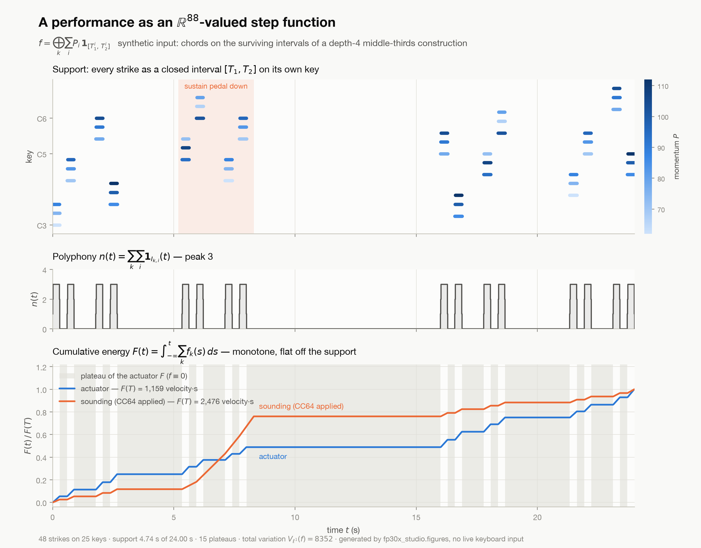

# The performance as a mathematical object

`fp30x_studio/performance.py` turns a take — a live `core.Capture` or a `.mid` on disk —
into the object it actually is, rather than a list of events.

A key struck with velocity `P` at `T1` and released at `T2` is the scaled indicator
`P · 1_[T1,T2]`. For one key those intervals are pairwise disjoint, because one actuator
cannot be in two states at once; that invariant is **checked and raised on**, at either
the strict grade (`I_i ∩ I_j = ∅`) or the a.e. grade (`λ(I_i ∩ I_j) = 0`, which is what a
legato repeat produces). The whole performance is the direct sum over the 88 keys,

```
f = ⊕_k Σ_i P_i · 1_[T1_i, T2_i] : ℝ → ℝ⁸⁸
```

an `ℝ⁸⁸`-valued step function of bounded variation. What the module computes from it:

- **total variation** `|Df|(ℝ)`, in `ℓ¹`, `ℓ²` or `ℓ∞` on `ℝ⁸⁸`
- **support measure** — the union across keys, not the sum
- **polyphony** `n(t) = Σ_k Σ_i 1_{I_k,i}(t)`, pointwise and as breakpoints
- **cumulative energy** `F(t) = ∫ f`, in closed form, with its plateau decomposition
- **evaluation** of the direct-sum vector at any `t`, and a structured-array / DataFrame export

The parser pairs note-ons to note-offs and reports every repair it had to make: orphan
note-ons, orphan note-offs, legato re-strikes on one key (the earlier interval is
truncated at the new onset — the hammer resets the string), zero-length notes, and notes
off the 88-key range. Sustain (CC64) maps the *actuator* representation to a *sounding*
one, extending each release that falls under the pedal.

```
python -m pytest tests/ -q            # 175 tests; the synthetic ones need no piano
python -m fp30x_studio.figures        # writes docs/cumulative-energy.png
```




# The pipeline: ingest once, ask many times

`fp30x_studio/pipeline/` turns a take into a materialised index — packets, messages,
paired intervals, defects, and one *role* per message — so that a measurement is a fold
over a table rather than another re-parse of the file.

```
python -m fp30x_studio.pipeline report 2026-08-17-piece    # is this take any good?
python -m fp30x_studio.pipeline queries                    # what can be asked
python -m fp30x_studio.pipeline query polyphony 2026-08-17-piece
python -m fp30x_studio.pipeline query key 2026-08-17-piece key=C4
python -m fp30x_studio.pipeline ingest --follow            # tail a take being recorded
```

`report` ingests first, so there is no step to remember. Ingest is **incremental**: the
`.fp30` format is append-only with monotone timestamps, so a byte offset plus the set of
keys currently down is a complete resume point, and the same code path serves a finished
take and one still being written. The index lives in `.index/` beside the take; it is
derived, deletable, and rebuilt by `ingest`.

Three properties, each bought by a specific failure:

- **Nothing is dropped.** Every message leaves the pairing layer with exactly one role —
  paired, orphaned, pedal, or explicitly classified — and the count of roles is asserted
  against the count of messages.
- **Nothing is recomputed by hand.** The pairing is computed once and written down, so two
  answers to the same question cannot disagree.
- **Nothing is inferred silently.** Each interval records *which observation closed it*, so
  a note-off that was never received cannot masquerade as a measured release; each take
  records how far its timestamps can be trusted, and timing-sensitive queries refuse to be
  quoted quietly against a poll-loop take.

The disjointness invariant in `performance.py` is not relaxed to accommodate bad data. A
re-strike closes the open interval **at the new onset** — the physically true reading, and
one that leaves the intervals meeting at a point, so `b_i ≤ a_{i+1}` still holds exactly.
No interval is invented; what is lost is only the release *time*, and the interval says so.

`integrity` reports health of the link, not of the playing: the 5 ms BLE arrival lattice
and its residue, the message-type census including the aftertouch null, and an inferred
loss rate. That last one is inference because it has to be — the capture tool's `dropped`
counter only sees packets CoreMIDI handed it, so radio-side loss is invisible to it by
construction. Every take's numbers are appended to the takes directory's `PROVENANCE.md`
automatically, once, the first time its stream is known to have ended.
